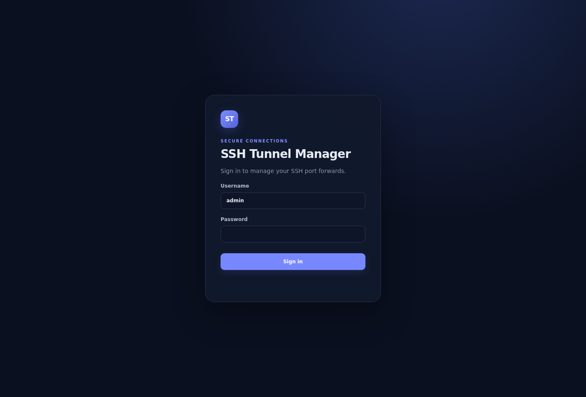
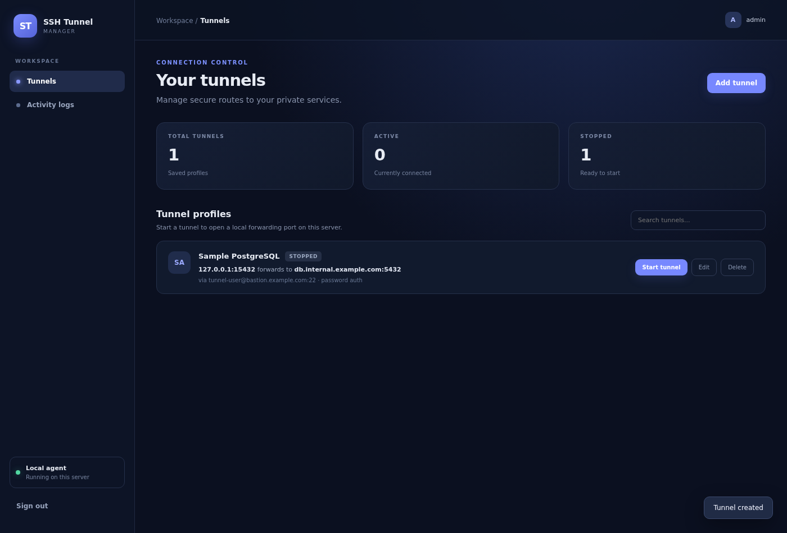
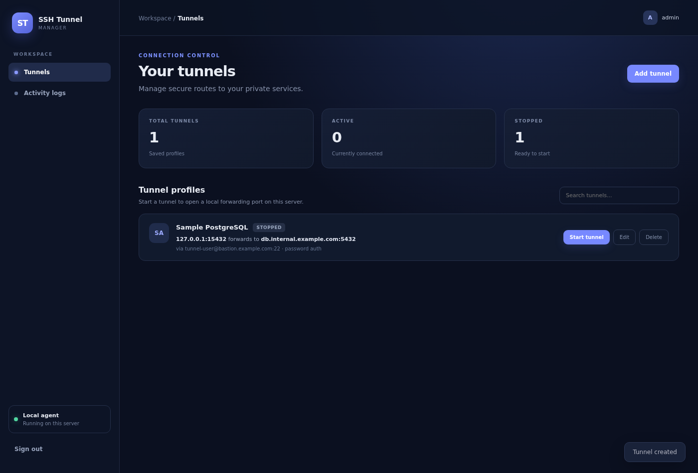
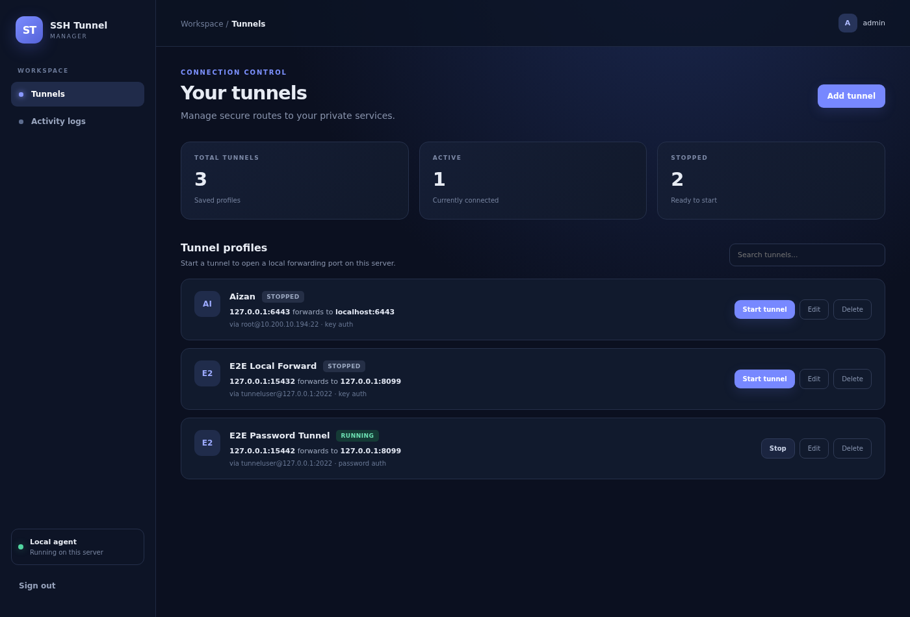
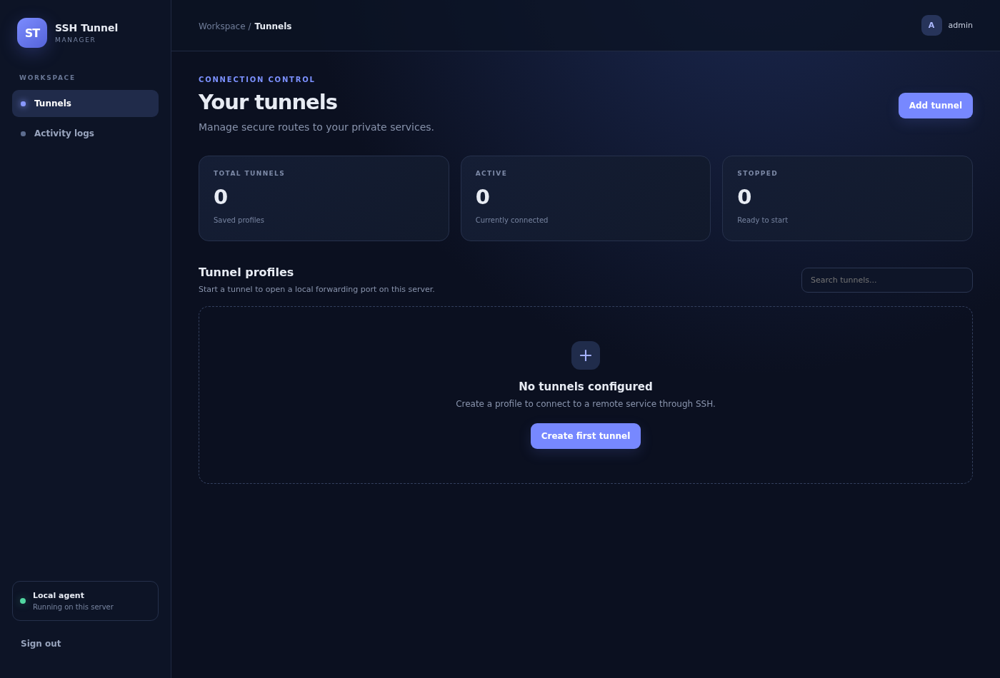

# SSH Tunnel Manager Web

A self-hosted web app for managing OpenSSH local port forwards from a Linux
server.



## Features

- Single admin login with session cookie, CSRF token and login rate limiting
- Add/edit/delete tunnel profiles
- Per-tunnel authentication: SSH key file or username/password
- Start/stop local SSH port forwards (`ssh -N -L`) with one click
- SQLite persistence in `./data` (survives restarts, auto-migrated schema)
- Live status refresh and recent SSH activity logs
- SSH host key checking is always enforced (`StrictHostKeyChecking=yes`)
- SSH key directory can be mounted read-only; keys never need to be copied
- Optional allowlists to restrict which SSH hosts and remote targets can be configured


## How it works

Each "tunnel" is a saved profile (SSH host/port/user, auth method, local bind
port, remote target). Clicking **Start** spawns:

```
ssh -N -T -p PORT [-i key | password-via-askpass] -L 127.0.0.1:LOCAL:REMOTE:PORT user@host
```

and the app promotes the tunnel to `running` only after the local forwarding
socket accepts connections. **Stop** sends SIGTERM (then SIGKILL after 3s).

## Requirements

- Linux with OpenSSH client (`ssh`) — tested with OpenSSH 8.2+
- Node.js **24.x** (uses the built-in `node:sqlite` and `process.loadEnvFile`)
- An SSH account on the remote host, authenticated either by:
  - a private key already present on this machine, **or**
  - the account's password (password authentication enabled on the SSH server)
- The remote host's host key trusted in a `known_hosts` file

## Setup on a new machine

### 1. Copy the project and install dependencies

```bash
# copy/clone the project somewhere, e.g.
cd /opt/ssh-tunnel-manager-web

# install the app's runtime dependencies (express etc.)
cd app
npm install --omit=dev
cd ..
```

### 2. Create the `.env` file

```bash
cp .env.example .env
chmod 600 .env
```

Then edit `.env` (see the next section for every variable). The **two values
you must change** are `ADMIN_PASSWORD` and `SESSION_SECRET`:

```bash
# generate strong values, then paste them into .env
openssl rand -base64 24   # -> ADMIN_PASSWORD
openssl rand -base64 48   # -> SESSION_SECRET
```

### 3. Prepare SSH access

**Option A — key authentication (recommended).** Make sure the private key
that can log into the remote host exists on this machine (default location
`~/.ssh/id_*`, or point `KEY_DIR` at the directory that holds it). The
matching `.pub`/authorized key must already be installed on the remote host.

**Option B — username/password.** Nothing to pre-install; you enter the SSH
username and password in the UI when creating the tunnel. The password is
stored in the local SQLite database (file mode `600`, never returned by the
API) and passed to `ssh` through a private `SSH_ASKPASS` helper — no
`sshpass` needed.

**In both cases**, trust the remote host's host key once (host key checking
is enforced, so tunnels to unknown hosts will refuse to start):

```bash
# default known_hosts is ~/.ssh/known_hosts; with KEY_DIR set it is $KEY_DIR/known_hosts
ssh-keyscan -p PORT bastion.example.com >> ~/.ssh/known_hosts
```

### 4. First run

```bash
cd app && node server.js
# -> "SSH Tunnel Manager listening on 9999"
```

Open http://localhost:9999/, sign in with `ADMIN_USERNAME`/`ADMIN_PASSWORD`
from `.env`, and create your first tunnel.

## `.env` reference

`.env` lives in the **project root** (one level above `app/`) and is read on
every start. Real environment variables (e.g. from systemd) take precedence
over the file.

| Variable | Required | Default | Description |
|---|---|---|---|
| `APP_PORT` | yes | `9999` | Port the web UI listens on. |
| `ADMIN_USERNAME` | yes | `admin` | Web UI login name. |
| `ADMIN_PASSWORD` | yes | — | Web UI login password. **Minimum 16 characters**, the app refuses to start otherwise. |
| `SESSION_SECRET` | yes | — | Cookie signing secret. **Minimum 32 characters**; generate with `openssl rand -base64 48`. |
| `SESSION_SECURE` | no | `false` | Set to `true` only when serving over HTTPS (cookies get the `Secure` flag). |
| `KEY_DIR` | no | `~/.ssh` | Directory holding SSH private keys (mounted read-only in Docker). The UI only accepts a filename from this directory, never a path. |
| `KNOWN_HOSTS_FILE` | no | `$KEY_DIR/known_hosts` | Trusted SSH host keys. Populate with `ssh-keyscan -p PORT host`. |
| `DATA_DIR` | no | `./data` | Where `tunnels.sqlite` is stored. Back this up if you care about your profiles. |
| `SSH_BIN` | no | `ssh` | Path to the OpenSSH client binary. |
| `ALLOWED_SSH_HOSTS` | no | *(empty = allow all)* | Comma-separated allowlist of SSH hosts (names or IPs) that profiles may use. **Keep restrictive in production.** |
| `ALLOWED_REMOTE_TARGETS` | no | *(empty = allow all)* | Comma-separated allowlist of remote target hosts for forwards. |

Minimal example:

```dotenv
APP_PORT=9999
ADMIN_USERNAME=admin
ADMIN_PASSWORD=change-me-to-something-long
SESSION_SECRET=change-me-to-at-least-32-random-characters
SESSION_SECURE=false

# KEY_DIR=/home/youruser/.ssh
# KNOWN_HOSTS_FILE=/home/youruser/.ssh/known_hosts
# ALLOWED_SSH_HOSTS=bastion.example.com,10.20.0.10
# ALLOWED_REMOTE_TARGETS=db.internal.example.com,10.20.0.25
```

## Running it as a systemd service

A ready-made unit file is in `app/ssh-tunnel-manager.service`. Install it with
your own paths/user:

```bash
sudo cp app/ssh-tunnel-manager.service /etc/systemd/system/ssh-tunnel-manager.service
sudo systemctl edit ssh-tunnel-manager.service   # optional: override paths
# at minimum adjust these in the unit file:
#   User=youruser
#   WorkingDirectory=/path/to/ssh-tunnel-manager-web/app
#   ExecStart=/path/to/node server.js
#   EnvironmentFile=-/path/to/ssh-tunnel-manager-web/.env

sudo systemctl daemon-reload
sudo systemctl enable --now ssh-tunnel-manager
systemctl status ssh-tunnel-manager
journalctl -u ssh-tunnel-manager -f        # logs
```

After changing `.env` or the code, apply with:

```bash
sudo systemctl restart ssh-tunnel-manager
curl -s http://localhost:9999/health        # -> {"ok":true}
```

> Note: tunnels that were running are stopped by a restart; start them again
> from the UI (the profiles themselves are kept in SQLite).

## Running with Docker

```bash
docker build -t ssh-tunnel-manager app/

mkdir -p data ssh-keys            # volumes for state and keys
cp .env.example .env && chmod 600 .env   # then edit it as described above

docker run -d --name ssh-tunnel-manager --restart unless-stopped \
  -p 9999:9999 \
  --env-file .env \
  -e KNOWN_HOSTS_FILE=/run/ssh-keys/known_hosts \
  -v "$PWD/data:/app/data" \
  -v "$HOME/.ssh:/run/ssh-keys:ro" \
  ssh-tunnel-manager
```

The key directory is mounted **read-only**; profiles reference key
*filenames* inside it. `known_hosts` inside the mounted directory is used for
host key verification, so run `ssh-keyscan` into
`ssh-keys/known_hosts` (or mount your own).

## Using the web UI

- **Add tunnel** — fill in name, SSH host/port/user, local port and remote
  target, and pick the authentication method:
  - *SSH key (recommended)*: the key filename from `KEY_DIR` (e.g. `id_rsa`).
  - *Username & password*: the SSH password; leave the field **blank on
    edit** to keep the saved password. The saved password is never shown
    again after saving.

  

  A saved password-auth profile looks like any other card, labelled with its
  auth method:

  

- **Start / Stop** — one click; the badge shows `starting` → `running` →
  `stopped`. Verify the forward from the host with
  `ss -ltn | grep PORT` or `curl http://127.0.0.1:PORT/`.

  

- **Edit / Delete** — a tunnel must be stopped before editing or deleting.
- **Activity logs** — recent lifecycle events plus raw SSH diagnostics
  (e.g. auth failures), useful when a tunnel refuses to start.



## Security notes

- Change `ADMIN_PASSWORD` and `SESSION_SECRET` before first start; the app
  refuses weak values.
- Set `ALLOWED_SSH_HOSTS` / `ALLOWED_REMOTE_TARGETS` in production so the UI
  can only create tunnels you actually intend.
- Saved SSH passwords live in `data/tunnels.sqlite` (kept mode `600`) and are
  never returned by the API; prefer key authentication where possible.
- Host key checking is always on — there is no "skip verification" switch.
- Serve behind HTTPS (and set `SESSION_SECURE=true`) if the UI is reachable
  beyond localhost.

## Verification / tests

An end-to-end suite drives the real UI in headless Chrome against a local
test SSH endpoint and target service (no Docker needed):

```bash
# needs: python3 + paramiko, google-chrome, puppeteer-core (npm i -g puppeteer-core)
bash test/run.sh
```

It covers: login, key-auth tunnel create/start/verify-via-curl/stop, the
password-auth flow (create → edit keeps saved password → password never
exposed via API → start → traffic verified → stop → delete), and host-namespace
checks of the forwarded ports. Use `APP_PORT=9998 bash test/run.sh` to run it
on a spare port while the real service is up.

## Troubleshooting

| Symptom | Fix |
|---|---|
| `SSH host key ... not trusted` / logs show `Host key verification failed` | `ssh-keyscan -p PORT host >> $KNOWN_HOSTS_FILE` |
| `SSH key file not found in ...` | The key filename must exist directly inside `KEY_DIR`; check `ls -l $KEY_DIR` and file permissions (`600`). |
| Tunnel stays `starting`, logs show `Permission denied (publickey,password)` | Wrong key/user, or the key isn't authorized on the remote host. For password tunnels: wrong password, or password auth disabled on the server. |
| Tunnel stays `starting`, logs show connection timeout | Wrong host/port, or a firewall blocking the SSH port. |
| `Local port already configured by ...` | Another profile already binds that local port. |
| App exits: `ADMIN_PASSWORD must be at least 16 characters` / `SESSION_SECRET must be at least 32 characters` | Fix the corresponding `.env` values. |

## Credits

Self-contained web implementation for managing OpenSSH local port forwards.
